 

  

<!-- Add your portfolio when ready:

-->

  

 

## About Me

I am a **BBA (Hons) Business Analytics** student at **Brainware University, Barasat**. I like turning raw data into clear answers that help a business decide what to do next.

I work across the full analytics process: **query** data with SQL, **clean and explore** it with Python (Pandas), **analyze** trends in Excel and Python, and **present** results in Power BI. I am looking for a **Business Analyst or Business Intelligence internship** where I can learn from a real team and add value quickly.

**What I bring**

- 🗄️ **SQL:** I design and query databases using joins, `GROUP BY`, `HAVING`, filters and aggregate functions
- 🐍 **Python:** I clean real-world data with Pandas: missing values, duplicates and inconsistent formats
- 📈 **Analysis:** I use pivot tables, correlation and simple regression to explain what the numbers mean
- 📊 **Dashboards:** I am building my Power BI and DAX skills with hands-on practice
- 🧭 **Discipline:** I learn one skill at a time, finish projects and publish them on GitHub

 

 

## Toolkit

| Area | Tools |
|---|---|
| **Data querying** |  |
| **Cleaning & analysis** |     |
| **BI & visualization** |   |
| **Environments** |    |
| **Workflow** |   |

## Featured Projects

| Project | What I did | Tools | Date |
|---|---|---|---|
| [**Kolkata Sales & Customer Analysis**](https://github.com/analyst-suroj/Kolkata-Sales-and-Customer-Analysis) | Cleaned and merged multiple datasets, then used pivot-table analysis to find sales trends and customer patterns | `Python` `Pandas` | Jul 2025 |
| [**Food Delivery SQL Project**](https://github.com/analyst-suroj/food-delivery-sql-project) | Designed and queried a simulated food delivery database using `WHERE`, `LIKE`, `ORDER BY`, `LIMIT`, `UPDATE`, `ALTER` and NULL handling | `MySQL` | Aug 2025 |
| [**Supermarket Sales Trends & Seasonality**](https://github.com/analyst-suroj/Analise-sales-trends-and-seasonal-patterns-in-supermarket-chain-) | Studied sales trends and seasonal patterns with correlation analysis and simple regression | `Excel` | May 2025 |

## Experience

**Data Science Intern** · SkillCraft Technology (Remote) · *Oct 2025 – Nov 2025*

- Cleaned and preprocessed real-world datasets (for example, the Titanic dataset) using Python and Pandas
- Handled missing values, duplicates and inconsistent formatting
- Used exploratory data analysis (EDA) to find patterns and prepare data for further analysis
- Worked remotely on structured, task-based project workflows

## Education

**BBA (Hons) in Business Analytics** · Brainware University, Barasat · *Expected 2029*

## Certifications

| Certification | Issuer | Year |
|---|---|---|
| Data Analytics Job Simulation | Deloitte (via Forage) | 2026 |
| Introduction to Power BI | DataCamp | 2026 |
| Introduction to DAX in Power BI | DataCamp | 2026 |
| Introduction to Python | DataCamp | 2026 |

 

 

## Currently Focusing On

- 📊 Building Power BI dashboards with DAX measures
- 🐍 Getting stronger with Python and Pandas for cleaning and analysis
- 🎯 Applying for Business Analyst and BI internships

## Let's Connect

I would be glad to talk about internships, projects or ideas in business analytics.

📧 **surojkarmakar.office@gmail.com** · 💼 [LinkedIn](https://www.linkedin.com/in/suroj-karmakar-8504a035b)

 

